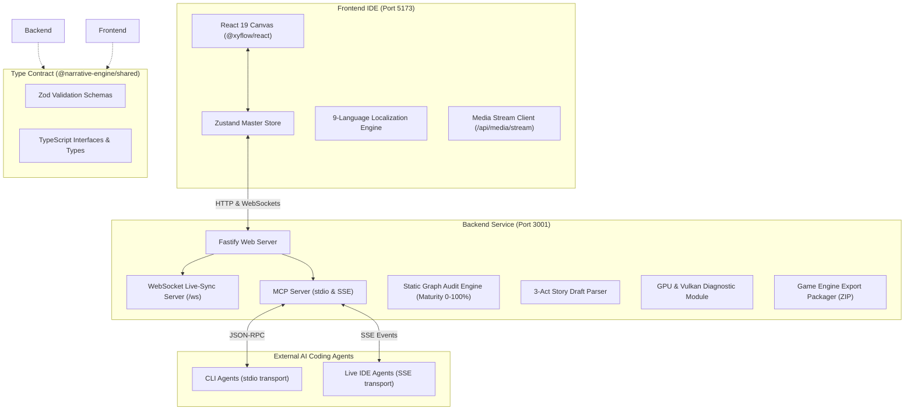

# Narrative Engine: Technical Postmortem & Engineering Playbook for AI Agents 🧠🤖

> **Target Audience:** Future AI Coding Agents (Google Antigravity, Claude Code, Codex, Cursor, Roo Code) and Lead Engineers.
> **Purpose:** Comprehensive knowledge transfer, architectural blueprint, documented pitfalls, and battle-tested solutions established during the development of Narrative Engine v3.
> **Project Author:** Markus Marrei (Маркус Маррей) `<markus.marrei@gmail.com>`.

---

## 1. System Overview & Technology Stack

**Narrative Engine** is a local visual narrative development environment and narrative-to-code compiler equipped with a native Model Context Protocol (MCP) server. It bridges human creative writing with autonomous game engine code generation (Unity, Godot, Web).



### Full Tech Stack Reference

| Layer | Technologies | Key Packages & Tooling |
| :--- | :--- | :--- |
| **Monorepo Architecture** | npm workspaces | 3 packages: `shared`, `backend`, `frontend` |
| **Frontend UI / IDE** | React 19, TypeScript 5.7 | `@xyflow/react` v12, `zustand`, `lucide-react`, `tailwindcss`, `vite` v6 |
| **Backend Core** | Node.js (20+ / 26), TypeScript 5.7 | `fastify` v5, `@fastify/websocket`, `@fastify/cors`, `archiver`, `mime-types` |
| **Agent Protocols (MCP)** | Model Context Protocol v1.6.0 | `@modelcontextprotocol/sdk` (dual-transport: `stdio` + `SSE`) |
| **Type Safety & Contracts**| Shared schemas | `zod` v3, full JSON Schema validation |
| **Hardware Telemetry** | Native OS child processes | Vulkan 1.3 telemetry, AMD / NVIDIA / Intel GPU detection |
| **Build & Deploy** | Cross-platform shell & batch | `start_windows.bat`, `start_linux_mac.sh`, `scripts/free_ports.ps1` |

---

## 2. Core Architectural Decisions

### 2.1. Action-Based Ordered Sequence Stacks (No Canvas Spaghetti)
* **The Problem:** Traditional visual scripting tools (Twine, standard node graphs) spawn separate nodes for every background change, sound effect, and dialogue line, rapidly devolving into an unreadable "spider-web".
* **Our Solution:** Each scene node (`SceneContainerNode`) owns an **atomic, ordered sequence stack**:
  1. `show_background` (asset reference + transition type)
  2. `play_music` (audio file + volume setting)
  3. `dialogue` (speaker ID + portrait emotion + speech line + voice-over)
  4. `camera_effect` (screen shake, flash, visual overlay, direction notes)
  5. `choices` (branching decisions with state preconditions and mutations)

### 2.2. Dual-Transport Model Context Protocol (MCP)
* **`stdio` Transport:** Entrypoint `backend/dist/mcp/stdioRunner.js`. Designed for host agents (Antigravity, Claude Code) spawning headless subprocesses.
  * *Critical Rule:* All diagnostic and lifecycle messages **must** use `console.error` (stderr). `stdout` is strictly reserved for JSON-RPC messages.
* **`SSE` Transport:** Listens on `http://127.0.0.1:3001/sse`. Enables real-time browser synchronization: when an agent invokes a tool (e.g., `narrative_import_draft` or `narrative_link_scenes`), mutations are broadcast via WebSockets to React Flow immediately.

### 2.3. Non-Destructive Local Media Streaming
* Rather than importing multi-gigabyte video/audio assets into the project bundle during editing, nodes store local paths.
* Fastify's `/api/media/stream?path=...` proxies files with range requests (HTTP 206) for smooth seeking of audio and cutscenes.
* Upon export (`narrative_export_bundle`), assets are sanitized, deduplicated, and packaged into a standalone distribution ZIP.

---

## 3. Postmortem: Pitfalls, Root Causes, and Battle-Tested Solutions

### Issue 1: Browser Security Blocking Local File Paths (`Not allowed to load local resource`)
* **Symptom:** When a user entered a local Windows path (e.g. `C:\Users\...\Gemini_Image.jpg`) in the `SCENE BACKGROUND` node, the image failed to load, and `onError` hid the image, leaving an empty gray rectangle.
* **Root Cause:** Modern Chromium/WebKit security boundaries forbid web pages loaded over `http://localhost` from requesting local `file:///` URLs or raw OS drive letters.
* **Anti-Pattern:** Attempting to convert `C:\...` to `file:///C:/...` in the DOM (blocked by browser).
* **The Verified Solution:**
  1. Frontend helper `resolveImageUrl(src)` detects local paths:
     ```typescript
     export function resolveImageUrl(urlOrPath: string): string {
       if (!urlOrPath) return '';
       const trimmed = urlOrPath.trim();
       if (/^(https?:\/\/|data:|blob:)/.test(trimmed)) return trimmed;
       const clean = trimmed.replace(/^file:\/\/\/?/, '');
       return `/api/media/stream?path=${encodeURIComponent(clean)}`;
     }
     ```
  2. Fastify backend endpoint `/api/media/stream` decodes the path and checks:
     - Direct absolute path
     - Fallbacks relative to backend working directory, project root, and `frontend/public/`
  3. For file inputs (`<input type="file" />`), generate an instant session preview using `URL.createObjectURL(file)`.

---

### Issue 2: Node Resize Resets & Clashing Drag Handles in React Flow
* **Symptom:** Dragging the resize handle of `SceneContainerNode` caused the container size to reset or snap back unexpectedly. Resize dots at rounded corners visually clashed with the container's styling.
* **Root Cause:** React Flow's `<NodeResizer />` corner handles conflicted with custom `rounded-2xl` CSS borders and triggered un-debounced state updates that reset layout state.
* **The Verified Solution:**
  1. Hide the ugly corner dots and enable seamless edge-line resizing.
  2. Set strict minimum constraints: `minWidth={380}`, `minHeight={200}`.
  3. Separate visual dragging dimensions from the serialized manifest dimensions, committing updates on drag end.

---

### Issue 3: PowerShell 5.1 Command Chaining Syntax (`&&` Failure)
* **Symptom:** Shell commands chained with `&&` failed on Windows with `The token '&&' is not a valid statement separator in this version`.
* **Root Cause:** PowerShell 5.1 (the default pre-installed shell on Windows 10/11) only supports `;` for sequential statement separation. `&&` was introduced in PowerShell 7 Core.
* **The Verified Solution for Agents:**
  - **Always** chain dependent commands with `;` in PowerShell sessions:
    ```powershell
    # INCORRECT in PowerShell 5.1:
    npm run build:shared && npm run build:backend

    # CORRECT across all PowerShell versions:
    npm run build:shared ; npm run build:backend
    ```

---

### Issue 4: Headless Git Push Hanging Indefinitely (Windows Credential Manager)
* **Symptom:** Running `git push` via a script or agent on Windows hung forever with 0% CPU and an empty log.
* **Root Cause:** Git on Windows default global configuration has `credential.helper = manager`. In headless sessions (or non-interactive subagents), it attempts to spawn an invisible GUI authentication modal or wait on `stdin` for username/password.
* **The Verified Solution:**
  Always disable the terminal prompt and credential helper during automated git execution:
  ```powershell
  $env:GIT_TERMINAL_PROMPT = "0"
  git -c credential.helper= push https://<TOKEN>@github.com/<USER>/<REPO>.git main:main
  # Immediately reset remote URL to clean public address without token:
  git remote set-url origin https://github.com/<USER>/<REPO>.git
  ```

---

### Issue 5: GitHub Personal Access Token (PAT) Scope Rejection on Workflow Files
* **Symptom:** `git push` fails with:
  `! [remote rejected] main -> main (refusing to allow a Personal Access Token to create or update workflow .github/workflows/ci.yml without workflow scope)`
* **Root Cause:** Classic GitHub PATs (`ghp_...`) require the explicit `workflow` scope checkbox to create or modify anything inside `.github/workflows/`. If the user creates a token with only `repo` permissions, GitHub blocks the entire push.
* **The Verified Solution:**
  - For automated initial repo initialization, keep workflow definitions in `docs/ci-workflow.yml` or guide the user to enable the `workflow` checkbox on token generation.

---

### Issue 6: Hardcoded Personal File Paths in Repository State
* **Symptom:** The default demo project failed to load images on other machines because `project_state.json` contained `C:\Users\Маркус\OneDrive\Desktop\...`.
* **The Verified Solution:**
  - **Rule:** Never commit machine-specific drive letters or usernames in seed/sample data.
  - Normalize demo assets to relative paths: `"bg_image": "test_assets/bg_terminal.png"`.
  - Backend streaming resolver handles both absolute user paths (during active local authoring) and relative fallback paths (for repository demo content).

---

### Issue 7: Port Collisions (3001 & 5173) Preventing Server Launch
* **Symptom:** Restarting the application failed with `EADDRINUSE: address already in use :::3001`.
* **Root Cause:** Node processes spawned by background processes or abnormal terminations lingered, locking the TCP sockets.
* **The Verified Solution:**
  Created `scripts/free_ports.ps1`:
  ```powershell
  $ports = @(3001, 5173)
  foreach ($port in $ports) {
      $conns = Get-NetTCPConnection -LocalPort $port -ErrorAction SilentlyContinue
      if ($conns) {
          $conns.OwningProcess | Select-Object -Unique | ForEach-Object {
              Stop-Process -Id $_ -Force -ErrorAction SilentlyContinue
          }
      }
  }
  ```
  Integrated automatic port clearing directly into `start_windows.bat` before calling `npm run dev`.

---

### Issue 8: OneDrive EBUSY Locks During Temporary File Archiving
* **Symptom:** When compiling the game export zip directly inside workspace desktop folders, Windows / OneDrive sync engine intermittently locked files, throwing `EBUSY: resource busy or locked`.
* **The Verified Solution:**
  - In `compilerService.ts`, compile and stage all archive files inside `os.tmpdir()`:
    ```typescript
    const tempDir = fs.mkdtempSync(path.join(os.tmpdir(), 'narrative-export-'));
    // Build zip in tempDir, stream to completion, then copy final artifact
    ```

---

### Issue 9: Modal Layout Broken by Multi-Language Word Length Variations
* **Symptom:** Modal headers like "Narrative Engine MCP" wrapped into two lines in certain languages, breaking the header flexbox alignment.
* **The Verified Solution:**
  - Apply `whitespace-nowrap` on header action tags.
  - Keep modal titles concise (e.g., `'MCP'`).
  - Maintain parity across all 9 locale dictionary files (`frontend/src/i18n/locales/*.ts`).

---

## 4. Checklist & Operational Rules for Future AI Agents

When working on or extending **Narrative Engine**, every AI Agent must adhere to these rules:

1. **Commit Attribution:**
   - Every git commit **must** be authored by:
     `--author="Markus Marrei <markus.marrei@gmail.com>"`
2. **Protected Assets:**
   - **Never** modify or overwrite the master project banner:
     `Изображение\Narrative Engine - Markus Marrei.jpg`. Copy it to docs, but leave the original intact.
3. **Monorepo Build Order:**
   - Always build dependencies in sequence:
     1. `npm run build:shared` (compiles Zod schemas and TypeScript interfaces)
     2. `npm run build:backend` (compiles Fastify & MCP stdio runner)
     3. `npm run build:frontend` (compiles Vite React 19 app)
4. **Token Security:**
   - Never commit tokens, passwords, or credentials into repository files or git history.
   - Strip tokens from git remote URLs immediately after pushing.
5. **Clean MCP Output:**
   - In any MCP tool or runner script, never use `console.log` for debugging. Output all logs to `console.error` to protect stdio JSON-RPC integrity.
6. **Cross-Platform Path Hygiene:**
   - Always use `path.normalize()`, `path.resolve()`, or URL encoding when passing paths between the frontend web layer and Node.js.

---

*Document compiled and verified for Narrative Engine v3.*
