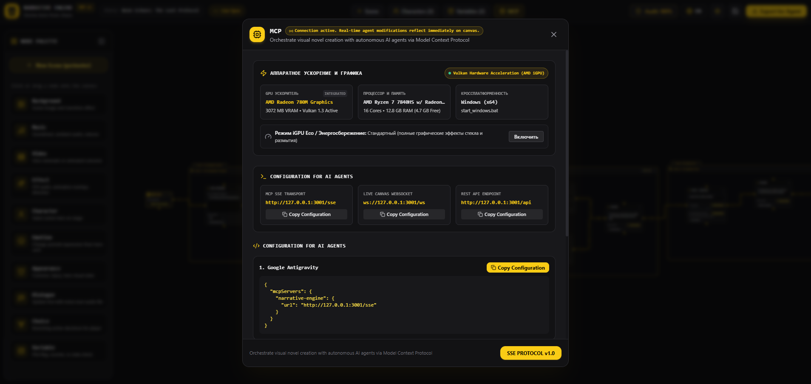
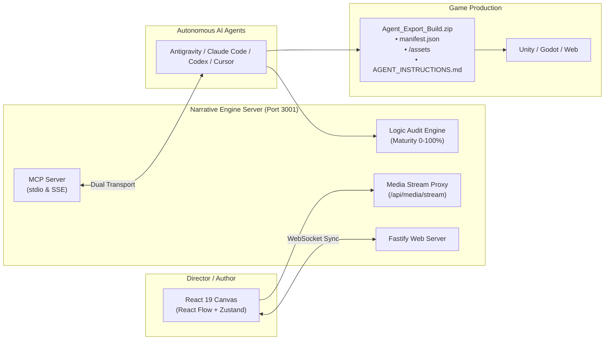

<p align="center">
  
</p>

<p align="center">
  <strong>Narrative-to-Code Orchestrator & Visual Story IDE with Native Model Context Protocol (MCP)</strong>
</p>

<p align="center">
  <a href="LICENSE"></a>
  <a href="https://nodejs.org/"></a>
  <a href="https://react.dev/"></a>
  <a href="https://fastify.dev/"></a>
  <a href="https://modelcontextprotocol.io/"></a>
  <a href="https://www.typescriptlang.org/"></a>
  <a href="README_RU.md"></a>
</p>

---

## 📖 Overview

**Narrative Engine** is a high-performance local visual development environment designed for writers, game designers, and AI coding agents. It bridges high-level creative story direction with autonomous game engine code generation (Unity, Godot, and Modern Web).

Instead of treating story scripts as passive text documents, Narrative Engine turns interactive branching fiction into a **strictly typed, mathematically verifiable narrative graph** that AI agents can inspect, audit, modify, and compile in real time through the **Model Context Protocol (MCP)**.

---

## 📸 Visual Showcase

### 1. Interactive 3-Act Canvas (Dark Mode)
Full workspace overview displaying scenes organized across Exposition, Conflict, and Climax with non-linear choice branches and state conditions.


---

### 2. High-Density Scene Inspector (Light Mode)
Zoomed-in view of action-based sequence stacks, background preview pipeline, and audio-visual transitions.


---

### 3. Core Modals & Engineering Panels

| Character & Sprite Manager | Story Variables & State Flags | Native MCP & Hardware Telemetry |
| :---: | :---: | :---: |
|  |  |  |
| *Register hero profiles, emotion sprites, and costumes with local file pickers.* | *Manage boolean flags, numerical counters, and narrative state dependencies.* | *Real-time dual-transport (stdio & SSE), live sync, and GPU hardware acceleration.* |

---

## 🌟 Key Features

### 🎬 Action-Based Ordered Sequence Stacks
Traditional node editors create chaotic "canvas spaghetti" by spawning separate cards for every dialogue, image change, and SFX. Narrative Engine structures each scene as an **atomic, ordered action stack**:
1. `show_background` — Asset resolution with transition effects (Fade, Cut, Slide).
2. `play_music` — Ambient audio and soundtrack control with volume normalization.
3. `dialogue` — Spoken lines with speaker identity, portrait emotion, and voice-over tracks.
4. `camera_effect` — Visual overlays, screen shake, and director cues.
5. `choices` — Player decision points with state condition checks (`has_key == true`) and variable mutations (`karma += 5`).

### 🤖 Dual-Transport Model Context Protocol (MCP)
Built from the ground up to support autonomous AI coding agents:
- **`stdio` Transport:** Spawned via `node backend/dist/mcp/stdioRunner.js` for CLI agents (**Google Antigravity**, **Claude Code**, **Codex**). Diagnostic logs are routed to `stderr`, leaving `stdout` pure for JSON-RPC.
- **`SSE` Transport:** Listens on `http://127.0.0.1:3001/sse`. When an agent edits the story or imports a script, changes stream instantly to the browser canvas via WebSockets.

### 📁 Non-Destructive Local Media Pipeline
- Authors point directly to multi-gigabyte local asset folders without copying files into the project.
- The built-in streaming endpoint `/api/media/stream` serves local audio and images directly to the browser, bypassing `file://` security restrictions.
- Includes folder picker buttons and live image previews right on the canvas cards.

### ⚡ Hardware Telemetry & GPU Detection
Built-in hardware diagnostic module automatically detects:
- GPU vendor & model (AMD Radeon, NVIDIA GeForce, Intel Arc/Iris).
- Vulkan 1.3 hardware acceleration status.
- Dedicated vs. Integrated GPU power modes with low-power battery-saving profiles.

### 🔍 Automated Story Logic Audit
One-click audit engine performs graph validation:
- Detects unreachable dead-ends and orphan scenes.
- Flags infinite cycles that lack state-mutating exit conditions.
- Identifies undeclared variables and type mismatches.
- Computes a comprehensive **Maturity Score (0–100%)**.

### 🌍 Multi-Language Localization
Fully translated and localized in **9 languages**:
English (en), Russian (ru), German (de), French (fr), Spanish (es), Italian (it), Japanese (ja), Korean (ko), and Portuguese (pt).

### 📦 1-Click Game Engine Export
Compiles the narrative into an isolated `Agent_Export_Build.zip` containing:
- Clean, schema-validated `manifest.json`.
- Sanitized local `/assets` directory.
- Tailored `AGENT_INSTRUCTIONS.md` enabling AI agents to scaffold complete visual novel implementations in **Unity** (C#) or **Godot** (GDScript).

---

## 🏛 Architecture & Workflow



---

## 🚀 Quick Start

### 1-Click Launch (Windows)
Double-click **`start_windows.bat`**. The launcher will:
1. Detect Node.js (18+) and npm.
2. Auto-release ports 3001 and 5173 if previously occupied.
3. Build shared type schemas.
4. Launch Backend and Frontend concurrently.
5. Automatically open `http://localhost:5173` in your default browser.

### 1-Click Launch (Linux / macOS)
```bash
chmod +x start_linux_mac.sh
./start_linux_mac.sh
```

### Manual CLI Setup
```bash
# 1. Clone repository
git clone https://github.com/MarkusMarrei/narrative-engine.git
cd narrative-engine

# 2. Install workspace dependencies
npm install

# 3. Build shared schema package
npm run build:shared

# 4. Start Development Servers
npm run dev
```

---

## 📡 Connecting AI Agents via MCP

Narrative Engine can be controlled by any MCP-compatible AI assistant.

### Google Antigravity & Claude Desktop (`stdio` mode)
Add this to your MCP configuration file (`mcp.json` or `claude_desktop_config.json`):

```json
{
  "mcpServers": {
    "narrative-engine": {
      "command": "node",
      "args": [
        "<PATH_TO_NARRATIVE_ENGINE>/backend/dist/mcp/stdioRunner.js"
      ]
    }
  }
}
```

### Cursor, Windsurf, Roo Code (`SSE` live mode)
When running `start_windows.bat`, connect directly to the active live server:

```json
{
  "mcpServers": {
    "narrative-engine-live": {
      "url": "http://127.0.0.1:3001/sse",
      "transport": "sse"
    }
  }
}
```

---

## 🛠 Native MCP Tools Reference

| Tool Name | Parameters | Description |
| :--- | :--- | :--- |
| **`narrative_get_project`** | *none* | Reads the entire story state, metadata, acts, character definitions, variable registries, and scene nodes. |
| **`narrative_audit_project`** | *none* | Runs static analysis on the graph: checks for orphan nodes, dead ends, loops without variable conditions, and missing files. Returns 0–100% score. |
| **`narrative_import_draft`** | `raw_text`, `project_title` | Ingests raw narrative text (50,000+ chars), automatically partitions it into scenes across 3 acts, parses dialogue speakers, and populates the canvas. |
| **`narrative_create_scene`** | `node_id`, `title`, `act_id`, `dialogue_text`, `speaker`, `bg_image`, `music_file`, `is_terminal` | Programmatically instantiates a new scene with specified action nodes. |
| **`narrative_update_scene`** | `node_id`, `title`, `append_dialogue`, `is_terminal` | Modifies existing scene properties or appends new dialogue lines. |
| **`narrative_link_scenes`** | `from_node_id`, `to_node_id`, `label`, `condition`, `effects` | Creates branching player decisions with state preconditions and variable mutation effects. |
| **`narrative_export_bundle`** | `target_engine` (`generic` \| `unity` \| `godot`) | Packages a clean, standalone zip bundle containing sanitized manifests and assets. |

---

## 📁 Repository Structure

```
narrative-engine/
├── .github/
│   ├── workflows/ci.yml           # Cross-platform automated build CI
│   └── ISSUE_TEMPLATE/            # Bug report & feature request templates
├── docs/
│   ├── banner.jpg                 # Official Narrative Engine project banner
│   └── screenshots/               # Fullscreen and modal UI showcase images
├── backend/
│   ├── src/
│   │   ├── mcp/                   # Model Context Protocol server & stdio runner
│   │   ├── auditService.ts        # Graph maturity & deadlock detection
│   │   ├── compilerService.ts     # Engine export packager
│   │   ├── draftImporter.ts       # Raw text to 3-act canvas parser
│   │   ├── hardwareDetector.ts    # Vulkan & GPU telemetry
│   │   ├── projectStore.ts        # Master manifest state store
│   │   └── index.ts               # Fastify HTTP, SSE & WebSocket server
│   └── package.json
├── frontend/
│   ├── src/
│   │   ├── components/            # Canvas nodes, modals, header, palette
│   │   ├── i18n/                  # 9 languages localization system
│   │   ├── store/                 # Zustand state management
│   │   ├── App.tsx
│   │   └── main.tsx
│   ├── index.html
│   └── vite.config.ts
├── shared/
│   ├── src/                       # Type-safe schemas and interfaces (Zod)
│   └── package.json
├── test_assets/                   # Sample audio, backgrounds, and character portraits
├── saved_projects/                # Demo project: "Neon Echoes: The Lost Protocol"
├── scripts/                       # Port management utilities (free_ports.ps1)
├── start_windows.bat              # 1-Click launcher for Windows
├── start_linux_mac.sh             # 1-Click launcher for Linux & macOS
├── mcp_config_example.json        # MCP agent configuration template
├── CONTRIBUTING.md                # Development & contribution guidelines
├── SECURITY.md                    # Security vulnerability reporting policy
├── LICENSE                        # Apache 2.0 License
└── README.md
```

---

## 👤 Author

**Markus Marrei (Маркус Маррей)**
- Email: [markus.marrei@gmail.com](mailto:markus.marrei@gmail.com)
- GitHub: [@MarkusMarrei](https://github.com/MarkusMarrei)

---

## 📄 License

This project is licensed under the **Apache License 2.0** — see the [LICENSE](LICENSE) file for details.
