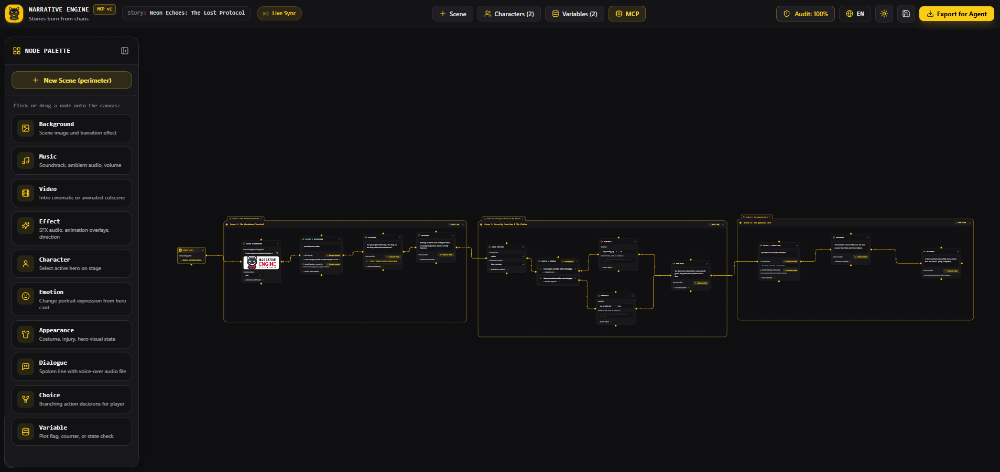
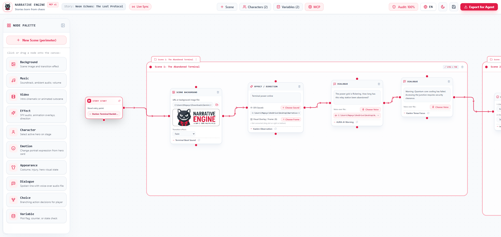
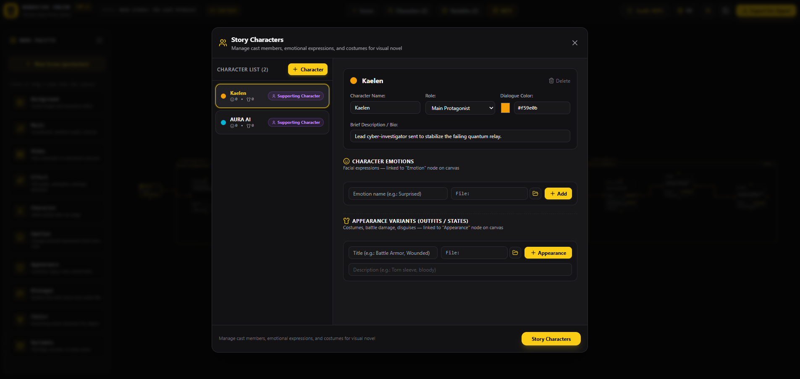
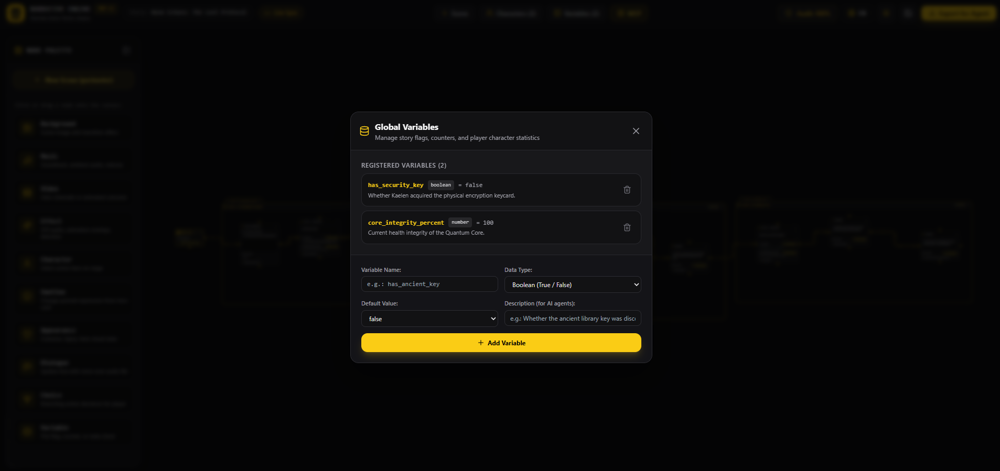

# Narrative Engine (`narrative-engine-mcp`) 🎭

> **Narrative-to-Code Orchestrator:** A local visual story editor with native Model Context Protocol (MCP) integration. Designed for authors to direct interactive fiction and for AI coding agents (Antigravity, Claude Code, Codex, Cursor) to construct verified games in Unity and Godot.

---

## 🌟 Core Architecture & Philosophy

```mermaid
flowchart LR
    Author["Author / Writer<br>(Visual React Flow Canvas)"] <--> |WebSocket Live Sync| Server["Narrative Engine Server<br>(Fastify + Non-Destructive Media)"]
    Server <--> |Model Context Protocol<br>(stdio & SSE)| Agent["AI Coding Agent<br>(Antigravity / Claude Code / Codex)"]
    Agent --> |Compiles Bundle| Export["Agent_Export_Build.zip<br>• Clean manifest.json<br>• Local /assets<br>• AGENT_INSTRUCTIONS.md"]
    Export --> GameEngine["Game Engine<br>(Unity / Godot / Custom Web)"]
```

### 1. Action-Based Nodes (No Canvas Spaghetti)
Unlike traditional visual scripting tools that spawn separate cards for every image, sound, and dialogue line, **Narrative Engine** represents each scene as an **ordered sequence stack**:
1. `show_background` (asset ID + transition)
2. `play_music` (audio asset + volume)
3. `dialogue` (speaker + text line)
4. `camera_effect` (screen shake / flash / fade)
5. `choices` (branching buttons with state conditions)

### 2. Dual-Transport Model Context Protocol (MCP)
Narrative Engine is built from the ground up as a native MCP server:
- **`stdio` Transport:** Spawns via `node backend/dist/mcp/stdioRunner.js` for standalone CLI agents.
- **`SSE` Transport:** Listens on `http://127.0.0.1:3001/sse` for live browser sessions. When the AI agent generates a branching dialogue or audits the narrative, the changes appear on the author's screen in real time.

### 3. Non-Destructive Editing & Asset Pipeline
- In edit mode, the editor saves absolute file paths on the user's computer without duplicating multi-gigabyte media files.
- The local backend safely streams local media directly to the browser at `/api/media/stream?path=...`, bypassing browser `file://` protocol restrictions.
- Upon export, assets are sanitized, renamed, copied to an isolated temporary build directory (`os.tmpdir()` to prevent OneDrive locking), and packed into a standalone `.zip`.

---

## 📸 Visual Showcase

| Dark Mode Canvas Overview | Light Mode Scene Zoom |
|:---:|:---:|
|  |  |

| Character Manager | Story Variables & State |
|:---:|:---:|
|  |  |

| Model Context Protocol & Hardware Acceleration Panel |
|:---:|
|  |

---

## 🛠 Technology Stack

- **Frontend:** React 19, TypeScript, Vite, `@xyflow/react` (React Flow), Zustand, Tailwind CSS, Lucide Icons.
- **Backend:** Node.js (v20+), Fastify, `@modelcontextprotocol/sdk`, `@fastify/websocket`, `archiver`, Zod.
- **Shared:** Shared type-safe interfaces and validation schemas (`@narrative-engine/shared`).

---

## 🚀 Quick Start (Windows / Linux / macOS)

### 1-Click Launch (Windows)
Double-click `start_windows.bat`. It will:
1. Check and auto-release ports 3001 and 5173.
2. Build the shared schema package.
3. Launch the Backend and Frontend processes in background tabs.
4. Open `http://localhost:5173` in your default browser.

### Manual Setup
```bash
# 1. Clone repository
git clone https://github.com/MarkusMarrei/narrative-engine.git
cd narrative-engine

# 2. Install monorepo dependencies
npm install

# 3. Build shared types
npm run build:shared

# 4. Start Backend (Terminal 1)
npm run dev:backend

# 5. Start Frontend (Terminal 2)
npm run dev:frontend
```

---

## 📡 Connecting External AI Agents

See [MCP_GUIDE.md](MCP_GUIDE.md) for full configuration recipes.

To connect **Google Antigravity** or **Claude Desktop**, add this to your MCP settings file:

```json
{
  "mcpServers": {
    "narrative-engine": {
      "command": "node",
      "args": [
        "<PATH_TO_NARRATIVE_ENGINE>/backend/dist/mcp/stdioRunner.js"
      ]
    }
  }
}
```

---

## 🔍 The 7 Native MCP Tools

1. **`narrative_get_project`**: Read entire narrative state, acts, variables, and node hierarchy.
2. **`narrative_audit_project`**: Validate story logic, detect circular loops, dead ends, and missing variables. Returns Maturity Score (0-100%).
3. **`narrative_import_draft`**: Ingest a 50,000+ character story text, extract dialogue speakers, and populate the 3-act canvas automatically.
4. **`narrative_create_scene`**: Programmatically generate a new scene in a specific act.
5. **`narrative_update_scene`**: Modify dialogues, title, or flags of an existing scene.
6. **`narrative_link_scenes`**: Create choice branches with conditions (`has_key == true`) and state effects (`karma + 5`).
7. **`narrative_export_bundle`**: Compile and package a clean `Agent_Export_Build.zip` for game engine code generation.

---

## 📄 License
Apache License 2.0. Authored by **Markus Marrei** (`markus.marrei@gmail.com`).
