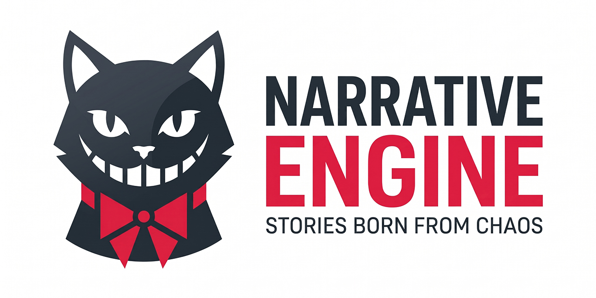
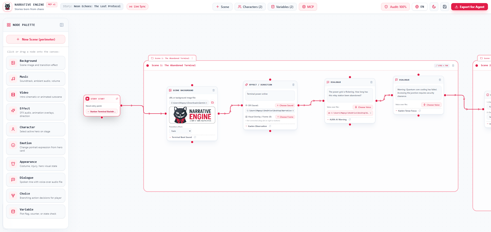
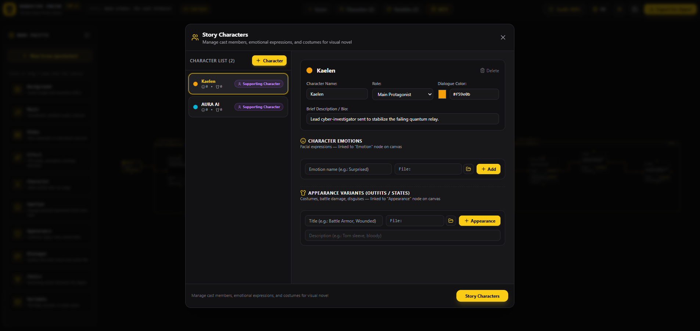
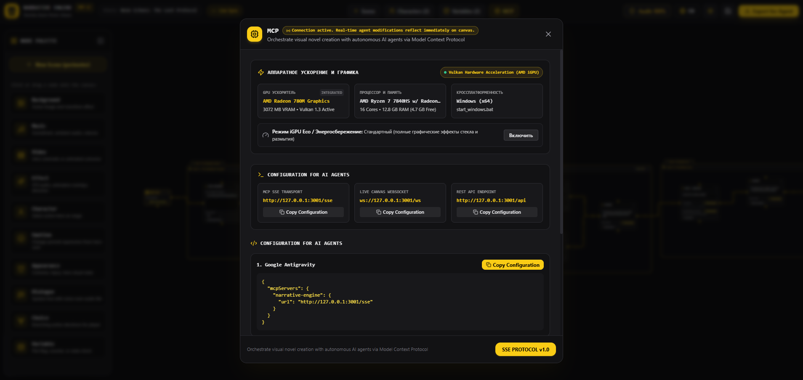
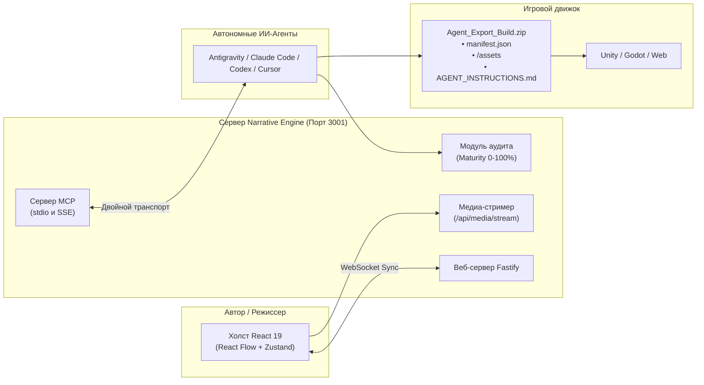

<p align="center">
  
</p>

<p align="center">
  <strong>Narrative-to-Code Orchestrator: Визуальная IDE интерактивных историй с нативной поддержкой Model Context Protocol (MCP)</strong>
</p>

<p align="center">
  <a href="LICENSE"></a>
  <a href="https://nodejs.org/"></a>
  <a href="https://react.dev/"></a>
  <a href="https://fastify.dev/"></a>
  <a href="https://modelcontextprotocol.io/"></a>
  <a href="https://www.typescriptlang.org/"></a>
  <a href="README.md"></a>
</p>

---

## 📖 Описание проекта

**Narrative Engine** — это локальная среда визуальной режиссуры и проектирования интерактивных историй, созданная для сценаристов, геймдизайнеров и автономных ИИ-агентов. Проект соединяет творческий процесс написания сюжета и автоматическую сборку готовой кодовой базы для игровых движков (**Unity**, **Godot** и **Web**).

Вместо текстовых сценариев Narrative Engine оперирует **строго типизированным графом повествования**, который внешние ИИ-агенты (Google Antigravity, Claude Code, Cursor, Codex) могут исследовать, проверять на логические ошибки, дополнять и компилировать в реальном времени через **Model Context Protocol (MCP)**.

---

## 📸 Галерея интерфейса

### 1. Интерактивный 3-актный холст (Темная тема)
Обзор всего рабочего пространства: сцены разделены по структуре драмы (Экспозиция, Конфликт, Развязка), с ветвлением выборов и проверкой переменных.


---

### 2. Детальный инспектор сцены (Светлая тема)
Приближенный вид карточки сцены с цепочкой действий, встроенным выбором файлов на диске и предпросмотром фона.



---

### 3. Основные окна и модули управления

| Персонажи и эмоции | Переменные и флаги состояния | Панель MCP и телеметрия GPU |
| :---: | :---: | :---: |
|  |  |  |
| *Карточки героев, переключение спрайтов эмоций, выбор локальных артов.* | *Булевы флаги, числовые счетчики прогресса и условия переходов.* | *Статус stdio/SSE транспорта, Live Sync и аппаратное ускорение Vulkan.* |

---

## 🌟 Ключевые возможности

### 🎬 Событийные узлы без «спагетти» на холсте
Вместо хаотичного нагромождения карточек под каждую реплику и звук, каждая сцена в Narrative Engine представляет собой **упорядоченный стек действий**:
1. `show_background` — фон сцены с эффектами перехода (Fade, Cut, Slide) и предпросмотром.
2. `play_music` — управление фоновой музыкой и настройка громкости.
3. `dialogue` — диалоговая реплика с указанием говорящего, портрета эмоции и озвучки.
4. `camera_effect` — спецэффекты (встряска, вспышка, затемнение, режиссерские пометки).
5. `choices` — развилки выборов с проверкой условий (`has_key == true`) и мутацией состояния (`karma += 5`).

### 🤖 Двойной транспорт Model Context Protocol (MCP)
- **Транспорт `stdio`:** запуск через `node backend/dist/mcp/stdioRunner.js` для автономных консольных агентов (**Google Antigravity**, **Claude Code**, **Codex**). Логи выводятся в `stderr`, сохраняя `stdout` исключительно для валидного JSON-RPC.
- **Транспорт `SSE`:** прослушивание на `http://127.0.0.1:3001/sse`. Любые изменения агента мгновенно транслируются на холст автора через WebSockets.

### 📁 Неразрушающий медиа-пайплайн (Local Streaming)
- Авторы работают напрямую с тяжелыми локальными папками ассетов без их копирования в проект.
- Стриминговый эндпоинт `/api/media/stream` безопасно отдает аудио и графику в браузер, обходя ограничения безопасности протокола `file://`.
- Кнопки выбора файлов на диске и превью прямо в карточках нод.

### ⚡ Аппаратное ускорение и телеметрия GPU
Модуль аппаратной диагностики автоматически определяет:
- Видеокарту и процессор (AMD Radeon, NVIDIA GeForce, Intel).
- Поддержку аппаратного ускорения графики Vulkan 1.3.
- Энергоэффективный режим для встроенных видеокарт (iGPU Eco).

### 🔍 Автоматический аудит логики графа
Алгоритм статического анализа структуры сюжета:
- Находит забытые тупики и потерянные сцены-сироты.
- Предупреждает о бесконечных циклах без изменения состояния.
- Проверяет неиспользуемые переменные и несовпадения типов.
- Рассчитывает показатель зрелости проекта — **Maturity Score (0–100%)**.

### 🌍 Локализация на 9 языков
Полный перевод интерфейса: Русский (ru), Английский (en), Немецкий (de), Французский (fr), Испанский (es), Итальянский (it), Японский (ja), Корейский (ko), Португальский (pt).

### 📦 Экспорт для игровых движков в 1 клик
Сборка проекта в готовый архив `Agent_Export_Build.zip`:
- Валидный `manifest.json`.
- Очищенная папка `/assets` с относительными путями.
- Специализированная инструкция `AGENT_INSTRUCTIONS.md`, позволяющая AI-агенту автоматически собрать код игры на **Unity** или **Godot**.

---

## 🏛 Архитектура системы



---

## 🚀 Быстрый старт

### Запуск в 1 клик (Windows)
Запустите файл **`start_windows.bat`**. Лаунчер:
1. Проверит наличие Node.js (18+) и npm.
2. Автоматически освободит порты 3001 и 5173 при необходимости.
3. Соберет пакет общих схем.
4. Запустит бэкенд и фронтенд.
5. Автоматически откроет браузер по адресу `http://localhost:5173`.

### Запуск в 1 клик (Linux / macOS)
```bash
chmod +x start_linux_mac.sh
./start_linux_mac.sh
```

### Ручная установка через консоль
```bash
# 1. Клонирование репозитория
git clone https://github.com/MarkusMarrei/narrative-engine.git
cd narrative-engine

# 2. Установка зависимостей монорепозитория
npm install

# 3. Сборка пакета общих схем
npm run build:shared

# 4. Запуск в режиме разработки
npm run dev
```

---

## 📡 Подключение ИИ-агентов через MCP

### Google Antigravity и Claude Desktop (режим `stdio`)
Добавьте сервер в файл конфигурации (`mcp.json` или `claude_desktop_config.json`):

```json
{
  "mcpServers": {
    "narrative-engine": {
      "command": "node",
      "args": [
        "<PATH_TO_NARRATIVE_ENGINE>/backend/dist/mcp/stdioRunner.js"
      ]
    }
  }
}
```

### Cursor, Windsurf, Roo Code (режим `SSE`)
При запущенном сервере подключитесь к живому SSE-эндпоинту:

```json
{
  "mcpServers": {
    "narrative-engine-live": {
      "url": "http://127.0.0.1:3001/sse",
      "transport": "sse"
    }
  }
}
```

---

## 🛠 Таблица инструментов MCP

| Инструмент | Параметры | Назначение |
| :--- | :--- | :--- |
| **`narrative_get_project`** | *нет* | Получить полное состояние проекта: акты, персонажи, переменные, сцены и последовательности действий. |
| **`narrative_audit_project`** | *нет* | Статический анализ графа: поиск тупиков, сиротских сцен, бесконечных циклов и расчет оценки зрелости (0–100%). |
| **`narrative_import_draft`** | `raw_text`, `project_title` | Принять черновой текст (50 000+ символов), автоматически разбить на сцены по 3 актам, распарсить говорящих и визуализировать на холсте. |
| **`narrative_create_scene`** | `node_id`, `title`, `act_id`, `dialogue_text`, `speaker`, `bg_image`, `music_file`, `is_terminal` | Программно создать новую сцену с начальными действиями. |
| **`narrative_update_scene`** | `node_id`, `title`, `append_dialogue`, `is_terminal` | Отредактировать параметры сцены или дописать диалоги. |
| **`narrative_link_scenes`** | `from_node_id`, `to_node_id`, `label`, `condition`, `effects` | Создать ветвящийся выбор с условием по переменным и эффектами мутации состояния. |
| **`narrative_export_bundle`** | `target_engine` (`generic` \| `unity` \| `godot`) | Скомпилировать проект в чистый zip-пакет для передачи агенту-сборщику игры. |

---

## 👤 Автор

**Markus Marrei (Маркус Маррей)**
- Email: [markus.marrei@gmail.com](mailto:markus.marrei@gmail.com)
- GitHub: [@MarkusMarrei](https://github.com/MarkusMarrei)

---

## 📄 Лицензия

Проект распространяется под лицензией **Apache License 2.0** — подробности в файле [LICENSE](LICENSE).
