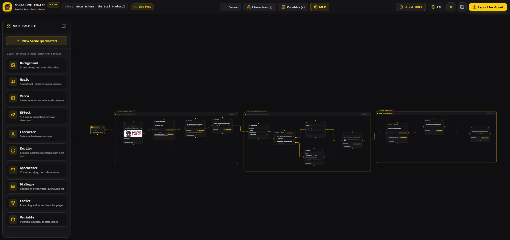
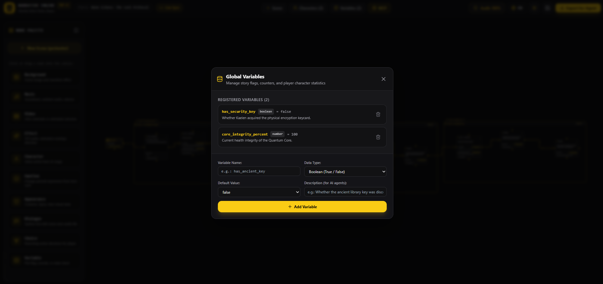

# Narrative Engine (`narrative-engine-mcp`) 🎭

> **Narrative-to-Code Orchestrator:** Локальный визуальный редактор интерактивных историй с нативным протоколом Model Context Protocol (MCP). Спроектирован для авторов (режиссура и написание сюжета) и автономных ИИ-агентов (Antigravity, Claude Code, Codex, Cursor), собирающих готовые игры в Unity и Godot.

---

## 🌟 Архитектура и принципы

```mermaid
flowchart LR
    Author["Автор сюжета<br>(Холст React Flow)"] <--> |WebSocket Live Sync| Server["Локальный сервер<br>(Fastify + медиа-стример)"]
    Server <--> |Model Context Protocol<br>(stdio и SSE)| Agent["ИИ-Агент<br>(Antigravity / Claude Code / Codex)"]
    Agent --> |Компиляция билда| Export["Agent_Export_Build.zip<br>• Чистый manifest.json<br>• Папка /assets<br>• AGENT_INSTRUCTIONS.md"]
    Export --> GameEngine["Игровой движок<br>(Unity / Godot / Web)"]
```

### 1. Событийные узлы (Action-Based Nodes)
В отличие от классических редакторов, где под каждую картинку и звук создается отдельная карточка, в **Narrative Engine** каждая сцена — это **упорядоченный стек действий**:
1. `show_background` (смена фона + переход)
2. `play_music` (музыкальный трек + громкость)
3. `dialogue` (говорящий персонаж + текст)
4. `camera_effect` (встряска экрана / вспышка / затемнение)
5. `choices` (кнопки выбора с условиями по переменным)

### 2. Поддержка двух транспортов MCP
Narrative Engine работает как нативный сервер Model Context Protocol:
- **Транспорт `stdio`:** Запуск через `node backend/dist/mcp/stdioRunner.js` для автономных консольных агентов.
- **Транспорт `SSE`:** Доступен на `http://127.0.0.1:3001/sse` при открытом редакторе. Любые правки агента мгновенно появляются на холсте автора в реальном времени.

### 3. Неразрушающий медиа-пайплайн (Non-Destructive Editing)
- При добавлении артов и звуков в проект сохраняются абсолютные локальные пути на ПК автора без дублирования тяжелых файлов.
- Сервер безопасно проксирует файлы в браузер по роуту `/api/media/stream?path=...`, обходя ограничения `file://`.
- При экспорте ассеты санитизируются, очищаются от кириллицы и пакуются в изолированную временную папку `os.tmpdir()` (защита от блокировок OneDrive).

---

## 📸 Галерея интерфейса

| Темная тема (Общий обзор холста) | Светлая тема (Приближение сцены) |
|:---:|:---:|
|  |  |

| Управление персонажами | Переменные и флаги состояния |
|:---:|:---:|
|  |  |

| Панель статуса MCP и аппаратного ускорения |
|:---:|
|  |

---

## 🚀 Быстрый старт (Windows)

### Запуск в 1 клик
Запустите файл **`start_windows.bat`**. Скрипт:
1. Проверит и освободит порты 3001 и 5173.
2. Проверит сборку пакета типов.
3. Запустит бэкенд и фронтенд в параллельных процессах.
4. Откроет редактор в браузере: `http://localhost:5173`.

---

## 🔍 7 нативных инструментов MCP

1. **`narrative_get_project`**: Получить полное состояние проекта (акты, сцены, переменные, ассеты).
2. **`narrative_audit_project`**: Глубокий аудит логики (поиск тупиков, потерянных веток, циклических петель, проверка переменных). Возвращает Maturity Score (0-100%).
3. **`narrative_import_draft`**: Принять черновик на 50 000+ символов, нарезать на сцены по 3 актам и разложить по холсту.
4. **`narrative_create_scene`**: Создать новую сцену в указанном акте.
5. **`narrative_update_scene`**: Отредактировать текст, реплики или флаги сцены.
6. **`narrative_link_scenes`**: Создать переход с условием проверки (`has_key == true`) и эффектами (`karma + 5`).
7. **`narrative_export_bundle`**: Скомпилировать проект в чистый `Agent_Export_Build.zip` для сборщика на Unity/Godot.

---

## 📄 Лицензия
Apache License 2.0. Автор: **Markus Marrei** (`markus.marrei@gmail.com`).
